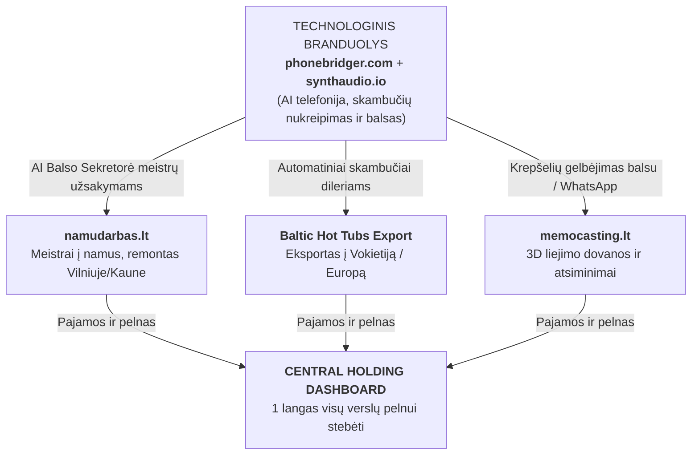

# AI HOLDINGAS: KAIP VALDYTI KELIS VERSLUS SU AUTONOMINIAIS AGENTAIS
### Naujausių 2026 m. rudens YouTube strategijų analizė ir diegimas jūsų verslams

---

## 1. NAUJAUSIOS 2026 M. RUDENS AGENTŲ TENDENCIJOS (YOUTUBE TYRIMAS)

Išanalizavus naujausius šio mėnesio vaizdo įrašus ir meistriškumo pamokas apie autonominius agentus, išryškėjo 4 esminiai lūžiai:

### A. „AI Holding Company“ (Chief of Staff) Modelis
Užuot kiekvienam verslui kūrus atskiras chaotiškas programas, sėkmingiausi operatoriai naudoja **Holdingo hierarchiją**:
* **Vyriausiasis Dispečeris (Chief of Staff):** 1 centrinis agentas, kuris koordinuoja dukterinius verslus.
* **Griežta duomenų izoliacija (Canon):** Kiekvienas verslas turi savo atskirą taisyklių, kontaktų ir produktų failą, kad agentai nesusipainiotų.
* **Tvirtinimo vartai (Approval Gates):** Savininkas telefone patvirtina TIK 3 dalykus: dideles sąskaitas, reklamų biudžeto didinimą ir nestandartines sutartis. Visa kita vyksta 100% automatiškai.

### B. „Speed-to-Lead < 60s“ (Atsakymo greitis lemia pardavimą)
Statistika rodo: jei su potencialiu klientu po užklausos formos ar krepšelio apleidimo susisiekiama **per mažiau nei 60 sekundžių** (WhatsApp žinute arba AI skambučiu), **pardavimo tikimybė išauga net 391%**.

### C. Nulinių kaštų infrastruktūra (Self-Hosted n8n + Local Python)
Vietoj to, kad mokėtų 200–500 $/mėn. už „Make.com“ ar „Zapier“, rinkos lyderiai pereina prie **vietinio kompiuterio Python skriptų arba nuosavo serverio n8n**. Tai leidžia vykdyti neribotą kiekį agentų užduočių už **0 €**.

### D. AI Balso Agentai (Voice AI: Vapi / Retell)
Revoliucinis šuolis: AI dabar geba realiu laiku atsiliepti telefonu natūraliu balsu be jokio juntamo vėlavimo (<500ms), atsakyti į klausimus, rezervuoti meistrą ar vizitą.

---

## 2. JŪSŲ VERSLŲ EKOSISTEMA IR TOBULA SINERGIJA

Jūsų turimi domenai ir projektai tarpusavyje sudaro **idealią, viena kitą stiprinančią ekosistemą**:

---

## 3. PLANAS KIEKVIENAM JŪSŲ VERSLUI

### 1. `namudarbas.lt` (Buitinės paslaugos ir meistrai Lietuvoje)
* **Problema:** Žmonės, kuriems reikia santechniko, elektriko ar meistro, nori atsakymo DABAR. Jei niekas nekelia ragelio – jie skambina kitam.
* **Agentų automatizacija:**
  1. **AI Sekretorė (Voice / Chat):** Atsiliepia į skambutį per 1 sekundę lietuviškai, paklausia gedimo, užrašo adresą ir laiką.
  2. **Dispečeris (SMS/Telegram):** Akimirksniu išsiunčia užsakymą laisvam meistrui.
  3. **Apmokėjimas:** Automatinė sąskaitos nuoroda SMS žinute po atlikto darbo.

### 2. `phonebridger.com` + `synthaudio.io` (JŪSŲ DIDŽIAUSIAS SKAITMENINIS POTENCIALAS)
* Šie du projektai yra ne šiaip svetainės – tai yra **B2B SaaS įrankiai**, kuriuos galima parduoti tūkstančiams verslų:
* **Produktas:** „AI Telefono Administratorė smulkiam verslui“ (odontologams, autoservisams, grožio salonams, nekilnojamojo turto brokeriams).
* **Verslo modelis:** Prenumerata 99 € – 199 € / mėnesį už tai, kad verslas niekada neprarastų nė vieno praleisto skambučio.
* **Kaip agentai tai parduoda:** Elena randa Lietuvos ir Europos klinikas bei servisus -> Klaus siunčia pasiūlymą: *„Ar žinote, kad praleidžiate 20% klientų skambučių po darbo valandų? Išbandykite mūsų AI administratorę nemokamai 7 dienas.“*

### 3. `memocasting.lt` (Emocinės dovanos ir 3D liejimas)
* **Speed-to-lead krepšelių gelbėjimas:** Po 15 min. nuo krepšelio apleidimo – automatinė padrąsinanti WhatsApp žinutė su video gidu ir nuolaidos kodu.
* **B2B vestuvių ir krikštynų fotografų tinklas:** Partnerystės komisinis 15%.

### 4. `Baltic Hot Tubs Export` (Kubilai Europoje)
* Didelės maržos B2B pardavimai (800–1,900 € pelnas nuo vieneto).
* Klausas ir Elena toliau siunčia konsultacinius pasiūlymus Vokietijos, Olandijos ir Prancūzijos glampingams.

---

## 4. PELNINGIAUSIOS NAUJOS NIŠOS, KURIAS AI GALI VALDYTI 100% AUTONOMIŠKAI

Jei norite prikurti dar daugiau pelningų verslų:

1. **Aukštos Maržos Medienos Gaminių Eksportas į Vakarų Europą (Arbitražas):**
   * *Produktai:* Pirtys-statinės (Sauna Barrels), moduliniai sodo nameliai (Garden Pods), ąžuoliniai stalai.
   * *Kodėl:* Visiškai identiškas modelis kubilams! Gamyba Lietuvoje pigi, o Vokietijoje / Skandinavijoje mokamos dvigubos kainos.
2. **Vietinio Verslo Reputacijos ir Atsiliepimų Valdymas (Reputation SaaS):**
   * Parduoti odontologams, restoranams ir servisams automatinį 5 žvaigždučių Google Reviews surinkėją ir atsakiklį po 49 €/mėn.
3. **Skaitmeniniai B2B Lead Generatoriai (Niche Directories):**
   * Specializuoti katalogai su mokama naryste specialistams (pvz., vestuvių paslaugų teikėjai, privatūs meistrai).
