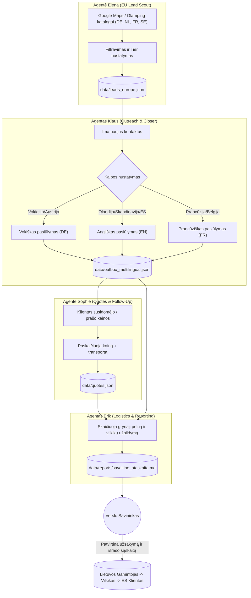

# SISTEMOS ARCHITEKTŪRA: KUBILŲ EKSPORTO AGENTŲ TINKLAS

Šiame dokumente pateikiama techninė schema, kaip agentai bendrauja tarpusavyje, kokius failus naudoja ir kaip duomenys cirkuliuoja sistemoje.

---

## 1. DUOMENŲ SRAUTO SCHEMA (MERMAID)

---

## 2. FAILŲ IR DUOMENŲ BAZIŲ ROLĖS

* `configs/kubilai_europa.json` – Pagrindinės taisyklės: modeliai (Premium 200cm, Deluxe 225cm), gamybos kainos Lietuvoje, pardavimo kainos Europoje, transporto tarifai pagal šalis.
* `data/leads_europe.json` – Surinkti potencialūs pirkėjai ir dileriai su kontaktais, kategorija ir šalimi.
* `data/outbox_multilingual.json` – Paruošti išsiuntimui profesionalūs laiškai vokiečių, anglų ir prancūzų kalbomis.
* `data/quotes.json` – Sugeneruoti komerciniai pasiūlymai su pilna komplektacija ir transporto kaina iki durų.
* `data/reports/` – Savaitinės verslo suvestinės savininkui apie grynajį pelną, parduotus kubilus ir dilerius.
